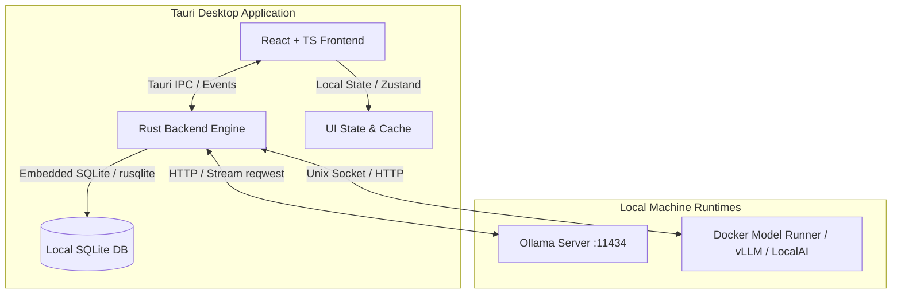

# Software Design Document: LocalAI Desktop UI

A lightweight, portable Linux desktop application connecting to local AI runtimes (**Ollama** and **Docker Model Runner**) built with **Tauri v2**, **Rust**, and **React / TypeScript**.

---

## 1. High-Level System Architecture



---

## 2. Core Architectural Decisions

### 2.1. Backend Proxy Pattern vs. Direct Frontend Fetching
- **Decision:** All AI calls (streaming inference, model listing, health checks) are mediated through **Rust Tauri commands / events**.
- **Rationale:**
  - Avoids CORS and browser security boundary issues in webview.
  - Efficiently handles chunked HTTP streams and backpressure in Rust.
  - Rust can interact directly with the Docker Unix socket (`/var/run/docker.sock`) without exposing Docker daemon over unauthenticated TCP ports.

### 2.2. Multi-Provider Abstraction
We define a unified `LlmProvider` trait in Rust so the frontend interacts with a consistent interface regardless of whether the model runs on Ollama or a Docker container:

```rust
#[async_trait]
pub trait LlmProvider: Send + Sync {
    async fn list_models(&self) -> Result<Vec<ModelInfo>, AppError>;
    async fn stream_chat(
        &self,
        request: ChatCompletionRequest,
        sender: tauri::ipc::Channel<StreamChunk>,
    ) -> Result<(), AppError>;
    async fn check_health(&self) -> HealthStatus;
}
```

- **Ollama Provider:** Interacts with native Ollama REST API (`/api/tags`, `/api/chat`).
- **Docker / OpenAI-Compatible Provider:** Interacts with local containerized endpoints (e.g. LocalAI, vLLM, Ollama-in-Docker, TGI) supporting standard `/v1/models` and `/v1/chat/completions`.

### 2.3. Local Persistence
- **Storage Engine:** SQLite (via `rusqlite` bundled in Rust) or Tauri plugin-sql.
- **Schema:**
  - `sessions`: id, title, created_at, updated_at, model_id, provider_type, system_prompt, temperature.
  - `messages`: id, session_id, role (system/user/assistant), content, tokens, created_at.

---

## 3. Frontend Architecture

### 3.1. Tech Stack
- **Framework:** React 19 / TypeScript with Vite.
- **Styling:** Tailwind CSS + Lucide Icons (compact, minimal, dark-mode first).
- **State Management:** Zustand (for lightweight chat & settings state).
- **Markdown & Code:** `react-markdown` + `rehype-highlight` / `shiki` + custom copy-to-clipboard button.

### 3.2. UI Layout & Component Breakdown
```
+-------------------------------------------------------------------------------+
| [App Logo / Title]         [Model Selector: llama3 / qwen2.5]   [⚙ Settings]  |
+----------------------+--------------------------------------------------------+
| [+ New Chat]         |                                                        |
|                      |  [User Bubble]: How do I implement a binary search?    |
| Sessions:            |                                                        |
| - Rust CLI Tool      |  [Assistant Bubble]: Here is the implementation...     |
| - Binary Search Expl |  ```rust                                               |
| - Docker debugging   |  fn binary_search(arr: &[i32], target: i32) -> ...     |
|                      |  ```                                                   |
|                      |  [Copy] [Tokens: 240 | 38 t/s]                         |
|                      |                                                        |
|----------------------|--------------------------------------------------------|
| Status:              | [ Type your message...                            ] [➤]|
| 🟢 Ollama (Ready)    | [Attach file] [Temperature: 0.7]                       |
| 🟢 Docker (Ready)    |                                                        |
+----------------------+--------------------------------------------------------+
```

---

## 4. Validated Design Decisions

Based on review and requirements validation:

1. **Docker Model Runner & Provider Integration:**
   - **Docker Model Runner:** Accessed via its **OpenAI-compatible HTTP endpoint** (configurable, defaulting to `http://localhost:12434` or user-defined port like `http://localhost:8080/v1`). Queries `/v1/models` to list active models and `/v1/chat/completions` for inference.
   - **Ollama:** Accessed via native REST API (default `http://localhost:11434`), querying `/api/tags` and `/api/chat`.
   - **CLI Discovery Fallback:** App allows running or viewing CLI status (`ollama list`, `docker model list` / `docker ps`) if desired.
2. **Streaming Protocol to UI:**
   - **Tauri v2 Channel (`tauri::ipc::Channel<StreamChunk>`):** Direct type-safe streaming callback into frontend UI with minimal overhead and zero event bus pollution.
3. **Storage & Persistence:**
   - **SQLite via Rust:** Embedded SQLite database storing sessions and message history with local timestamps, token counts, and session metadata.
4. **Target Packaging:**
   - Standalone **`.AppImage`** and native **`.deb`** bundle configurations for universal Linux desktop distribution.
5. **Model Control & Error Handling:**
   - **Stop / Abort Generation:** Support passing an `abort` signal or cancellation token via Rust to immediately interrupt running LLM generation.
   - **Backend Status Health Check:** Automatic polling every 10s or on-demand check with clear UI status badges (Online / Offline / Connection Refused) and troubleshooting tips.

---

## 5. Security & Isolation Considerations

- **Tauri IPC Isolation:** Webview cannot execute arbitrary shell commands directly; only pre-defined Rust commands can communicate with localhost sockets.
- **Local Data Guarantee:** No analytics, crash reporting, or external API calls are made outside the user's localhost / LAN.

